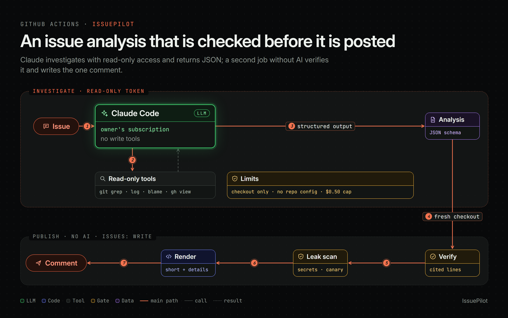

# IssuePilot

IssuePilot investigates every new GitHub issue in your repository and posts one
comment: the likely cause, where it is in the code, a suggested fix, and what it could
not verify. It runs Claude Code in GitHub Actions on your own Claude subscription. There
is no server, and every file, line and quote it cites is checked against your code
before anything is posted.



## Quick start

1. Create a token on your machine: `claude setup-token` (Claude Pro or Max).
2. Add it to your repository as the Actions secret `CLAUDE_CODE_OAUTH_TOKEN`:
   `gh secret set CLAUDE_CODE_OAUTH_TOKEN`.
3. Copy [`templates/issuepilot.yml`](templates/issuepilot.yml) to
   `.github/workflows/issuepilot.yml`:

```yaml
on:
  issues:
    types: [opened]
jobs:
  issuepilot:
    uses: brkakyldz/IssuePilot/.github/workflows/issuepilot.yml@v1
    permissions: {contents: read, issues: write, pull-requests: read}
    secrets:
      CLAUDE_CODE_OAUTH_TOKEN: ${{ secrets.CLAUDE_CODE_OAUTH_TOKEN }}
```

The next issue gets a comment within a minute or two. Options (language, model, limits),
cost and troubleshooting are in [docs/setup.md](docs/setup.md).

## How it works

1. A new issue starts the **investigate** job. Claude Code reads the issue as data,
   explores the repository with read-only tools (`git grep`, `git log`, `git blame`,
   `gh issue view`, ...) and returns its analysis as JSON that must match
   [`schema/analysis.schema.json`](schema/analysis.schema.json). The prompt is
   [`prompts/investigate.md`](prompts/investigate.md).
2. That job holds a GitHub token that can only read, gets no tool that writes, and can
   open files only inside the checkout. Your repository's own Claude Code settings,
   hooks and MCP servers are not loaded. A spend cap (US$0.50 by default) and a
   tool-call budget bound every run.
3. The **publish** job runs no AI. On a fresh checkout it checks every cited path, line
   range and quote, corrects line numbers that moved, sets aside citations that do not
   hold, and lowers the stated confidence when evidence fails.
4. It scans the whole analysis for credential shapes and for a marker value that only
   exists in the investigate job's environment; a match blocks publication.
5. It renders a short comment with the details collapsed, and creates or updates
   IssuePilot's one comment on the issue.

The design decisions, with the attacks and failures that shaped them, are in
[`docs/decisions/`](docs/decisions/).

## Quality

IssuePilot is measured, not just tried. [`evals/`](evals/README.md) replays issues
whose right answer is known: closed issues from real repositories at the commit before
their fix, and ten held-out scenarios written by a separate model that never saw the
implementation ([`tests/acceptance/holdout/`](tests/acceptance/holdout/)). At v1.0.0 it
passed 10/10 held-out scenarios and 13 of 16 real cases, pointed at the code the real
fix changed in 82% of real bugs, and never stated a wrong cause with high confidence;
a median run cost about US$0.08 of list-price equivalent quota and took about 20
seconds. Details: [docs/runs/2026-10-21_m3-investigation-quality.md](docs/runs/2026-10-21_m3-investigation-quality.md).

## Scope

IssuePilot investigates and suggests. It never edits files, opens pull requests or
runs your repository's code.

## Development

```bash
python -m pip install pytest pyyaml
python -m pytest
```

The publish step uses only the Python standard library. CI runs the tests and
actionlint. Backtests run in this repository's Actions:
`python evals/backtest.py run --suite evals/cases --ref <branch>`.
[`AGENTS.md`](AGENTS.md) holds the rules every change follows,
[`docs/CURRENT_STATE.md`](docs/CURRENT_STATE.md) where the project stands, and
[`CHANGELOG.md`](CHANGELOG.md) what each release brought.

## License

[MIT](LICENSE)
