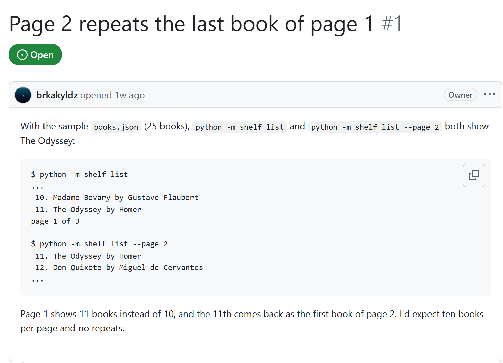
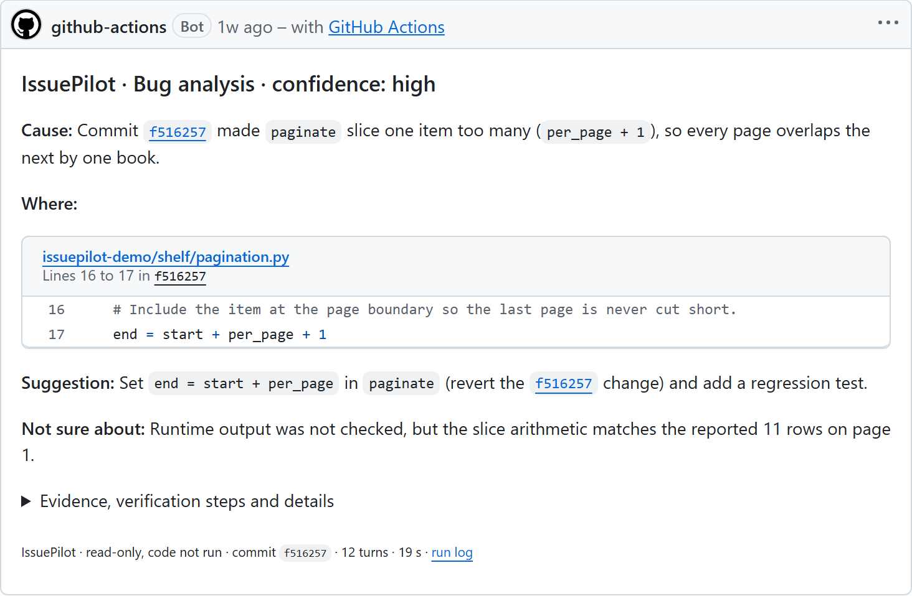
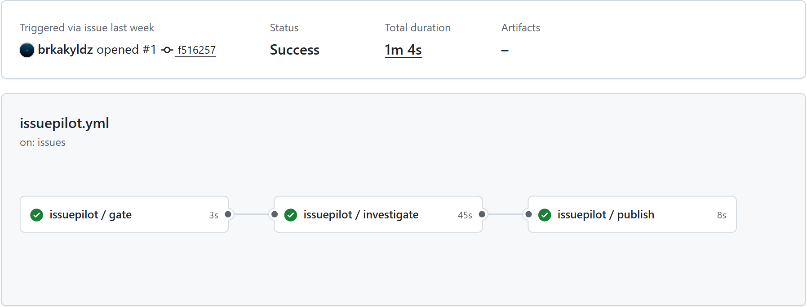

# IssuePilot

A reusable GitHub Actions workflow that investigates every new issue with Claude Code
and posts one comment: the likely cause, the lines involved, a suggested fix, and what
it could not verify.

[](https://github.com/brkakyldz/IssuePilot/releases/latest)
[](https://github.com/brkakyldz/IssuePilot/actions/workflows/ci.yml)

It runs on your own Claude subscription, needs no server, and checks every file, line
and quote it cites against your code before the comment is posted.

## Quick start

You need a Claude Pro or Max subscription and
[Claude Code](https://docs.anthropic.com/en/docs/claude-code) installed on your machine.

**1.** Create a token:

```bash
claude setup-token
```

**2.** Store it in your repository as the Actions secret `CLAUDE_CODE_OAUTH_TOKEN`:

```bash
gh secret set CLAUDE_CODE_OAUTH_TOKEN
```

**3.** Add `.github/workflows/issuepilot.yml`, a copy of
[`templates/issuepilot.yml`](templates/issuepilot.yml):

```yaml
name: IssuePilot

on:
  issues:
    types: [opened]
  # Run it by hand on an existing issue: Actions > IssuePilot > Run workflow.
  workflow_dispatch:
    inputs:
      issue_number:
        description: Issue number to investigate
        required: true

permissions: {}

jobs:
  issuepilot:
    uses: brkakyldz/IssuePilot/.github/workflows/issuepilot.yml@v1
    permissions:
      contents: read
      issues: write
      pull-requests: read
    secrets:
      CLAUDE_CODE_OAUTH_TOKEN: ${{ secrets.CLAUDE_CODE_OAUTH_TOKEN }}
    with:
      issue_number: ${{ inputs.issue_number }}
      language: English
```

The next issue opened in the repository gets a comment within a minute or two.
Troubleshooting and cost are in [docs/setup.md](docs/setup.md).

## What it does

A real run on the public demo repository
[brkakyldz/issuepilot-demo](https://github.com/brkakyldz/issuepilot-demo/issues/1).

### 1. Someone opens an issue

<picture>
  <source media="(prefers-color-scheme: dark)" srcset="docs/assets/issue-dark.png">
  
</picture>

### 2. IssuePilot replies

About a minute later, as `github-actions`:

<picture>
  <source media="(prefers-color-scheme: dark)" srcset="docs/assets/reply-dark.png">
  
</picture>

The short part answers the reporter; the evidence with quoted lines, verification steps
and assumptions are collapsed under it. Issues opened by bots or carrying a skip label
are left alone before any AI runs, and a run that fails posts a plain reason instead,
such as an expired token.

The run behind it, in GitHub Actions:

<picture>
  <source media="(prefers-color-scheme: dark)" srcset="docs/assets/run-dark.png">
  
</picture>

A 46-second video of the same run, from the bug to the cited code:

https://github.com/user-attachments/assets/1c9a514f-c1c2-4dcb-b7bb-00cdc6cc2a10

## How it works

1. **Gate.** A job without AI or token skips issues opened by bots and issues carrying
   one of `skip_labels` or `issuepilot:skip`.
2. **Investigate.** Claude Code reads the issue as data, explores the repository with
   read-only tools (`git grep`, `git log`, `git blame`, `gh issue view`, ...) and returns
   JSON that must match [`schema/analysis.schema.json`](schema/analysis.schema.json).
   The prompt is [`prompts/investigate.md`](prompts/investigate.md).
3. **Verify.** A second job with no AI checks every cited path, line range and quote on
   a fresh checkout, corrects line numbers that moved, sets aside citations that do not
   hold, and lowers the confidence when evidence fails.
4. **Leak scan.** The analysis is scanned for credential shapes and for a marker that
   only exists in the investigate job; a match blocks publication.
5. **Comment.** It creates or updates IssuePilot's one comment on the issue.

The decisions behind this design are in [`docs/decisions/`](docs/decisions/).

## Inputs

Set these under `with:` in your workflow. More in [docs/setup.md](docs/setup.md).

| Name | Description | Default |
|---|---|---|
| `issue_number` | Issue to investigate; defaults to the issue of the triggering event. | `""` |
| `language` | Language of the analysis and the comment. | `English` |
| `model` | Claude model alias or name. | `sonnet` |
| `max_turns` | Claude Code's turn limit; the tool-call budget is the real bound. | `60` |
| `max_tool_calls` | Hard bound on the agent's tool calls. | `40` |
| `max_cost_usd` | Hard bound on one run's spend at list-price equivalent. | `0.5` |
| `skip_labels` | Comma-separated labels; a new issue carrying one is not investigated. `issuepilot:skip` always applies. | `enhancement,feature,epic` |

Secret: `CLAUDE_CODE_OAUTH_TOKEN` (required), from `claude setup-token`.

## Security

- The investigating job gets `contents: read`, `issues: read` and `pull-requests: read`,
  and no tool that writes. Only the publish job, which runs no AI, has `issues: write`.
- Claude Code's file tools are confined to the checkout, and your repository's own
  Claude Code settings, hooks and MCP servers are not loaded.
- Every run is bounded by `max_cost_usd`, `max_tool_calls`, `max_turns` and job
  timeouts, and one issue never has two runs at the same time.

> [!IMPORTANT]
> IssuePilot investigates and suggests. It never edits files, opens pull requests or
> runs your repository's code.

## Quality

Measured three ways at v1.3.0: ten held-out scenarios written by a separate model
([`tests/acceptance/holdout/`](tests/acceptance/holdout/)), 23 backtests on closed issues
from real repositories ([`evals/`](evals/README.md)), and a field trial on 20 real issues
from pydantic, pandas, black, pytest, hono, vite and svelte.

| At v1.3.0 | Result |
|---|---|
| Held-out scenarios passed | 10 / 10 |
| Backtests passed | 18 / 23, pointed at the code the fix changed in 87.5% |
| Field trial: comments a maintainer would welcome | 17 / 20 (10 / 10 on closed issues) |
| Field trial: unhelpful or harmful comments | 0 |
| Wrong causes stated with high confidence | 0 |
| Median field-trial run | 11 turns, about US$0.13 of list-price equivalent quota |

The field-trial issues also shaped v1.3, so 17 / 20 is an upper bound for unseen
issues. Details and weak spots: [field trial 2](docs/runs/2026-10-22_field-trial-2.md).

## Development

```bash
python -m pip install pytest pyyaml
python -m pytest
```

The publish step uses only the Python standard library; CI runs the tests and
actionlint. Backtests and field trials are described in [`evals/README.md`](evals/README.md),
the rules every change follows in [`AGENTS.md`](AGENTS.md), and each release in
[`CHANGELOG.md`](CHANGELOG.md).

## License

[MIT](LICENSE)
