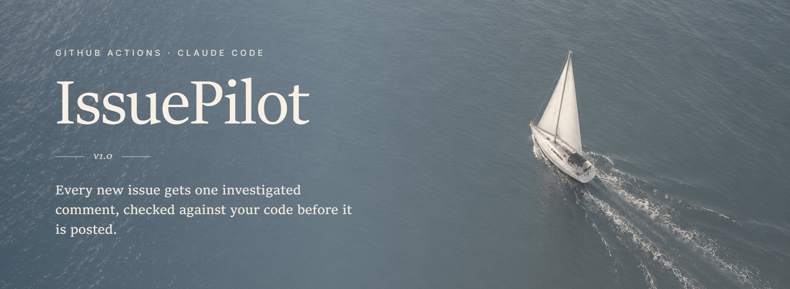
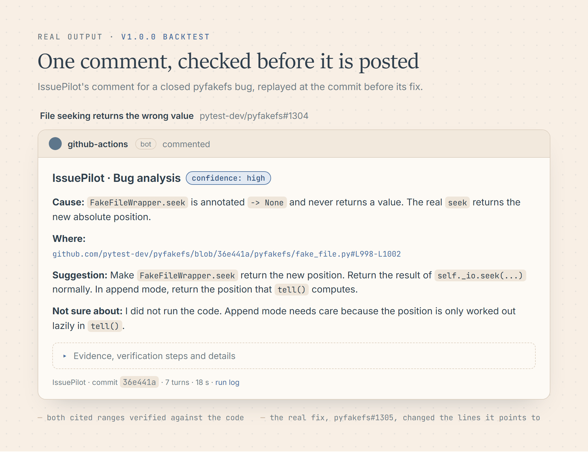
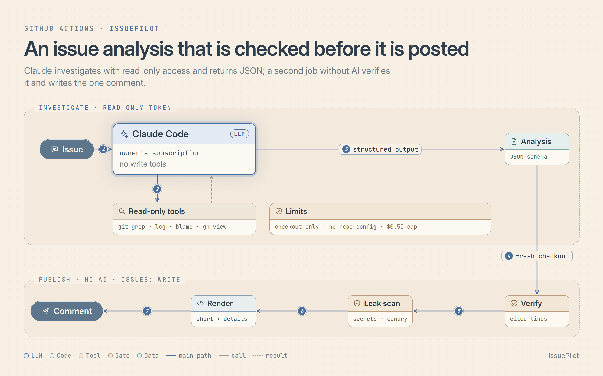

<p align="center">
  
</p>

<p align="center">
  <a href="https://github.com/brkakyldz/IssuePilot/releases/latest"></a>
  <a href="https://github.com/brkakyldz/IssuePilot/actions/workflows/ci.yml"></a>
  
  
  
</p>

<p align="center">
  <a href="#see-it-run">Demo</a> ·
  <a href="#quick-start">Quick start</a> ·
  <a href="#how-it-works">How it works</a> ·
  <a href="#quality">Quality</a> ·
  <a href="docs/setup.md">Setup guide</a>
</p>

IssuePilot investigates every new GitHub issue in your repository and posts one
comment: the likely cause, where it is in the code, a suggested fix, and what it could
not verify. It runs Claude Code in GitHub Actions on your own Claude subscription. There
is no server, and every file, line and quote it cites is checked against your code
before anything is posted.

## See it run

https://github.com/user-attachments/assets/1c9a514f-c1c2-4dcb-b7bb-00cdc6cc2a10

A 46-second walk through one real run on the public demo repository
[brkakyldz/issuepilot-demo](https://github.com/brkakyldz/issuepilot-demo/issues/1)
([`issuepilot-demo.mp4`](docs/assets/issuepilot-demo.mp4)). Every screen is the CLI's
output, a GitHub page or the run's own transcript:

1. **The bug.** `python -m shelf list` ends page 1 with *The Odyssey*, and page 2 starts
   with it again.
2. **Open an issue.** The report quotes both outputs.
3. **Run.** The gate, investigate and publish jobs start on their own, captured live in
   GitHub Actions.
4. **Investigate.** Claude Code's real tool calls, read-only, including
   `git show f516257`, the commit that added the `+ 1`.
5. **Verify.** The quoted lines are matched against a fresh checkout before anything is
   posted.
6. **Comment.** The cause, the cited lines, a suggested fix and what it is not sure about.
7. **Follow the code.** The permalink opens lines 16–17 at the commit IssuePilot read.

## What you get

<p align="center">
  
</p>

The comment above is IssuePilot v1.3.0's real output for
[honojs/hono#5129](https://github.com/honojs/hono/issues/5129), run in the field trial at
the commit just before the fix. The reporter had already named a cause, so the comment
says whether the code confirms it before adding anything; the real fix,
[honojs/hono#5131](https://github.com/honojs/hono/pull/5131), reuses the cached FormData
as suggested.

The short part answers the reporter; evidence with quoted lines, suggested fixes,
verification steps and assumptions are collapsed below it. Issues opened by bots or
labelled as feature requests are left alone before any AI runs, and a run that fails
posts a plain reason instead, such as an expired token.

## Quick start

1. Create a token on your machine: `claude setup-token` (Claude Pro or Max).
2. Add it to your repository as the Actions secret `CLAUDE_CODE_OAUTH_TOKEN`:
   `gh secret set CLAUDE_CODE_OAUTH_TOKEN`.
3. Copy [`templates/issuepilot.yml`](templates/issuepilot.yml) to
   `.github/workflows/issuepilot.yml`:

```yaml
on:
  issues:
    types: [opened]
jobs:
  issuepilot:
    uses: brkakyldz/IssuePilot/.github/workflows/issuepilot.yml@v1
    permissions: {contents: read, issues: write, pull-requests: read}
    secrets:
      CLAUDE_CODE_OAUTH_TOKEN: ${{ secrets.CLAUDE_CODE_OAUTH_TOKEN }}
```

The next issue gets a comment within a minute or two. Options (language, model, limits),
cost and troubleshooting are in [docs/setup.md](docs/setup.md).

## How it works



1. A **gate** job without AI or token skips issues opened by bots and issues carrying
   one of `skip_labels` (default `enhancement`, `feature`, `epic`) or `issuepilot:skip`.
2. Every other new issue starts the **investigate** job. Claude Code reads the issue as
   data, explores the repository with read-only tools (`git grep`, `git log`,
   `git blame`, `gh issue view`, ...) and returns its analysis as JSON that must match
   [`schema/analysis.schema.json`](schema/analysis.schema.json). Its first result is
   sent back once with a checklist (the issue's error text searched across the whole
   repository, the blamed function read to its end, every caller of the code a fix
   changes, assumptions one read would settle) while tool budget remains. The prompt is [`prompts/investigate.md`](prompts/investigate.md).
3. That job holds a GitHub token that can only read, gets no tool that writes, and can
   open files only inside the checkout. Your repository's own Claude Code settings,
   hooks and MCP servers are not loaded. A spend cap (US$0.50 by default) and a
   tool-call budget (40 by default) bound every run.
4. The **publish** job runs no AI. On a fresh checkout it checks every cited path, line
   range and quote, corrects line numbers that moved, sets aside citations that do not
   hold, and lowers the stated confidence when evidence fails.
5. It scans the whole analysis for credential shapes and for a marker value that only
   exists in the investigate job's environment; a match blocks publication.
6. It renders a short comment with the details collapsed, and creates or updates
   IssuePilot's one comment on the issue.

The design decisions, with the attacks and failures that shaped them, are in
[`docs/decisions/`](docs/decisions/).

## Quality

IssuePilot is measured, not just tried, in three ways:

- **Held-out scenarios:** ten issues written by a separate model that never saw the
  implementation ([`tests/acceptance/holdout/`](tests/acceptance/holdout/)).
- **Backtests:** 23 closed issues from real repositories, replayed at the commit before
  their fix ([`evals/`](evals/README.md)).
- **Field trial:** 20 real issues, open and closed, from pydantic, pandas, black,
  pytest, hono, vite and svelte, each comment reviewed by a separate model.

| At v1.3.0 | Result |
|---|---|
| Held-out scenarios passed | 10 / 10 |
| Backtests passed | 18 / 23, pointed at the code the fix changed in 87.5% |
| Field trial: comments a maintainer would welcome | 17 / 20 (10 / 10 on closed issues) |
| Field trial: unhelpful or harmful comments | 0 |
| Wrong causes stated with high confidence | 0 |
| Median field-trial run | 11 turns, about US$0.13 of list-price equivalent quota |

The field-trial issues were also used to make the v1.3 changes, so 17 / 20 is an upper
bound for issues it has not seen; the held-out and backtest suites check that nothing
else got worse. Details, including what is still weak:
[field trial 2](docs/runs/2026-10-22_field-trial-2.md),
[v1.0 quality report](docs/runs/2026-10-21_m3-investigation-quality.md).

## Scope

IssuePilot investigates and suggests. It never edits files, opens pull requests or
runs your repository's code.

## Development

```bash
python -m pip install pytest pyyaml
python -m pytest
```

The publish step uses only the Python standard library. CI runs the tests and
actionlint. Backtests run in this repository's Actions:
`python evals/backtest.py run --suite evals/cases --ref <branch>`; field trials use
`evals/field.py` ([`evals/README.md`](evals/README.md)).
[`AGENTS.md`](AGENTS.md) holds the rules every change follows,
[`docs/CURRENT_STATE.md`](docs/CURRENT_STATE.md) where the project stands, and
[`CHANGELOG.md`](CHANGELOG.md) what each release brought.

## License

[MIT](LICENSE)
